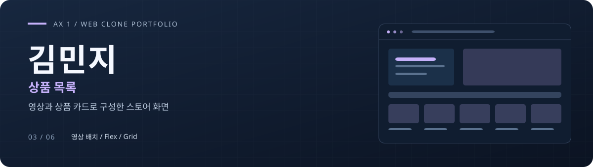
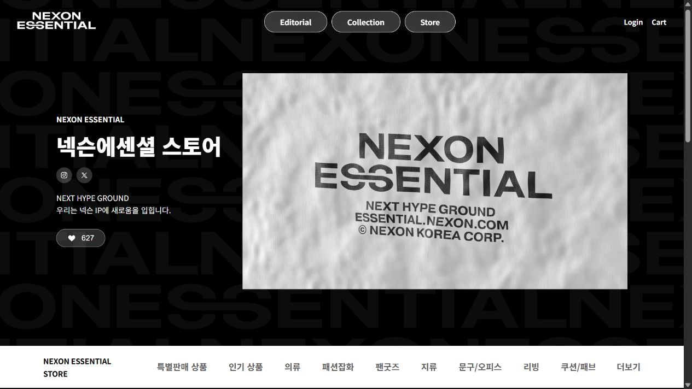

  

  <a href="../../README.md">프로젝트</a> / <a href="../../html/03_order_page.html">HTML</a> / <a href="../../css/03_order_page.css">CSS</a> / <a href="https://github.com/766min">GitHub</a>

<b>넥슨에센셜 스토어의 소개 영역, 영상, 카테고리 메뉴와 두 종류의 상품 목록을 구현했습니다.</b>

AX 1기 팀 프로젝트 / 상품 목록 / HTML5 / CSS3

[화면 미리보기](#화면-미리보기) / [구현한 내용](#구현한-내용) / [회고](#회고)

## 화면 미리보기

프로젝트 당시 캡처입니다. 이미지를 누르면 크게 볼 수 있습니다.

## 구현한 내용

| 영역 | 구현 내용 |
| --- | --- |
| **스토어 소개와 영상** | 소개 문구와 영상을 Flex로 배치하고, 배경 이미지 위에 반투명 메뉴를 얹었습니다. [CSS 보기 →](../../css/03_order_page.css#L100) |
| **카테고리 메뉴** | 스토어 이름과 상품 분류를 가로로 정렬하고, 원본 카테고리 페이지로 연결했습니다. [CSS 보기 →](../../css/03_order_page.css#L178) |
| **특별판매와 인기 상품** | 특별판매 상품은 Flex로, 인기 상품은 5열 Grid로 배치했습니다. [CSS 보기 →](../../css/03_order_page.css#L287) |
| **반복되는 상품 구성** | 이미지, 스토어 이름, 상품명과 판매 상태를 공통 카드 클래스로 묶어 두 목록에서 사용했습니다. [CSS 보기 →](../../css/03_order_page.css#L237) |

**구현 범위** — 데스크톱 상품 소개 화면을 구현했습니다. 화면 너비별 스타일은 초안이며 주문과 결제 기능은 포함하지 않습니다. 로컬 이미지 준비는 [실행 환경 안내](../../README.md#이미지와-실행-환경)를 참고하세요.

## 회고

프로젝트를 마친 당시의 경험과 생각을 정리한 글입니다.

### 어려웠던 점과 해결 과정

처음에는 페이지를 어떻게 나눠야 할지 감이 오지 않았다. 개발자 도구를 봐도 어디까지를 `section`으로 잡고, 그 안을 어떻게 `div`로 나눠야 할지 헷갈렸다. 팀원분이 이 정도를 `section`으로 잡고 그 안을 `div`로 나누면 된다는 식으로 알려주셔서 어느 정도 감을 잡을 수 있었다.

클래스가 점점 많아지면서 내가 지은 이름인데도 계속 헷갈려 많이 헤맸다. 클래스 이름을 짓는 방식을 찾아보고 어떻게 지을지 정리하고 나니 조금 덜 헷갈렸다.

제일 애먹었던 부분은 여백이었다. 시간이 부족해서 여백 개념을 다 공부하지 못한 채 코드를 짜다 보니 점점 꼬일 때가 있었다. 개념 공부를 더 하지는 못했고, 개발자 도구를 보면서 어느 부분에 여백을 얼마나 주었는지 확인하며 만들었다.

### 아쉬웠던 점과 다음 연습

내 페이지는 사진이 많이 들어가다 보니 딱 봤을 때는 있어 보였다. 그런데 막상 사진을 빼고 보면 내가 실제로 한 작업은 별로 없다는 느낌이 들었다. 사진이 적은 페이지를 맡은 다른 팀원들은 사진의 도움 없이 여백과 배치만으로 만들어야 했을 테니, 오히려 그게 더 어려운 작업이었을 것 같다.

다음에 한 번 더 연습할 때는 이미지가 적은 페이지를 골라보고 싶다. 여백 때문에 헤매지 않도록 개념도 더 공부해볼 생각이다.

---

[← 장예지 / 메인](장예지.md) / [프로젝트 README](../../README.md) / [양석호 / 고객센터 →](양석호.md)
