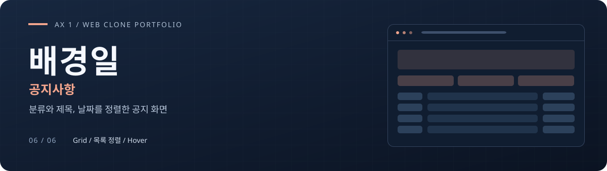
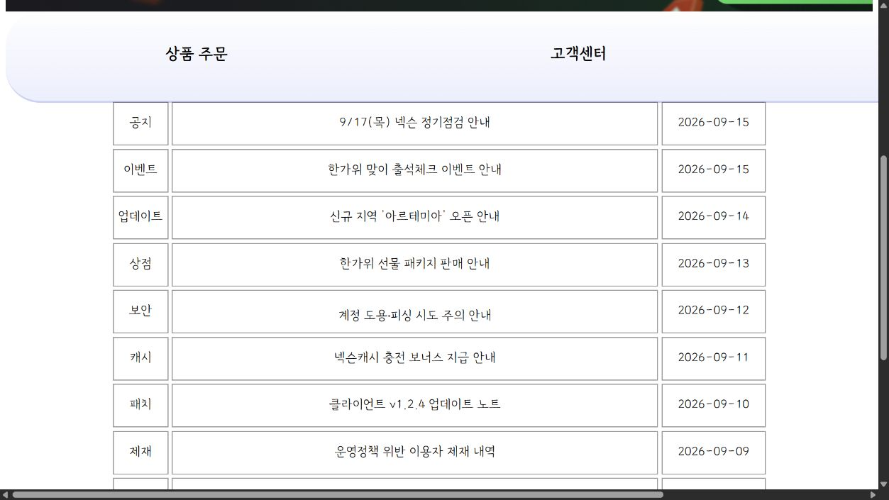

  

  <a href="../../README.md">프로젝트</a> / <a href="../../html/06_notice.html">HTML</a> / <a href="../../css/06_notice.css">CSS</a> / <a href="https://github.com/elfsai5-coder">GitHub</a>

<b>상단 배너와 팀 페이지 이동 메뉴, 분류와 제목 및 날짜를 나란히 보여주는 공지 목록을 구성했습니다.</b>

AX 1기 팀 프로젝트 / 공지사항 / HTML5 / CSS3

[화면 미리보기](#화면-미리보기) / [구현한 내용](#구현한-내용) / [회고](#회고)

## 화면 미리보기

프로젝트 당시 캡처입니다. 공지 목록을 보여주는 화면으로, 원본 구현의 가로 넘침도 포함되어 있습니다. 이미지를 누르면 크게 볼 수 있습니다.

## 구현한 내용

| 영역 | 구현 내용 |
| --- | --- |
| **헤더와 배너** | 로고와 로그인 링크를 Flex로 배치하고, 별도 영역에 배너 배경 이미지를 넣었습니다. [CSS 보기 →](../../css/06_notice.css#L23) |
| **페이지 이동 메뉴** | 상품 목록, 고객센터, 보안센터 링크를 Grid로 나누어 배치했습니다. [CSS 보기 →](../../css/06_notice.css#L57) |
| **공지 목록** | 분류, 제목, 날짜를 80px / 700px / 150px의 3열 Grid로 정렬했습니다. [CSS 보기 →](../../css/06_notice.css#L90) |
| **메뉴와 푸터 스타일** | 메뉴에 그라데이션과 hover 변화를 주고, 하단에는 정책 링크 문구와 회사 정보를 배치했습니다. [CSS 보기 →](../../css/06_notice.css#L74) |

**구현 범위** — 정적인 공지 목록과 페이지 연결을 구현했습니다. 게시글 상세 화면과 데이터 연동은 포함하지 않습니다. 로컬 이미지 준비는 [실행 환경 안내](../../README.md#이미지와-실행-환경)를 참고하세요.

## 회고

프로젝트를 마친 당시의 경험과 생각을 정리한 글입니다.

### 과제 이해와 소통

발표 팀을 정하기 20분 전에야 과제의 요지가 사이트를 카피하는 것이었다는 걸 깨달아 상당히 난처했다. 팀원들과 조금 더 이야기를 나눴다면 진작 알았을 문제라, 이 부분은 스스로 많이 아쉬웠다.

### 협업에서 아쉬웠던 점

처음 이야기했던 공용 CSS 파일 같은 것도 함께 만들었다면 어땠을까 생각한다. 협업하면서 해볼 수 있는 일이 더 있었을 것 같다. 다만 시간이 촉박했고, 나도 다른 팀원들도 HTML/CSS로 처음 무언가를 만들다 보니 서로의 작업까지 살펴볼 여유가 없었다.

### 결과물을 보며 느낀 점

이번에는 만들면서 스스로 타협을 많이 했다. 대충 이 정도면 되지 않을까, 좀 못생기긴 했는데 일단 필요한 건 다 들어있는 것 같다는 생각으로 넘어간 부분이 있었다.

그런데 다른 분들의 결과물을 직접 보고 나니, 피곤하고 머리가 아프다는 이유로 적당히 타협해서 내놓은 내 결과물이 아쉬웠다. 다음 팀 프로젝트에서는 다른 분들과 이야기도 더 많이 나누고, 결과물을 더 잘 만들기 위해 스스로 노력해야겠다고 느꼈다.

---

[← 이승주 / 보안센터](이승주.md) / [프로젝트 README](../../README.md)
