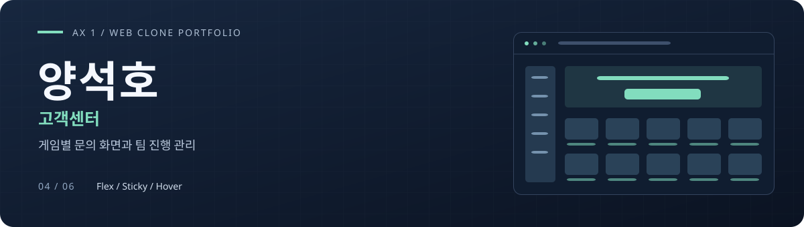
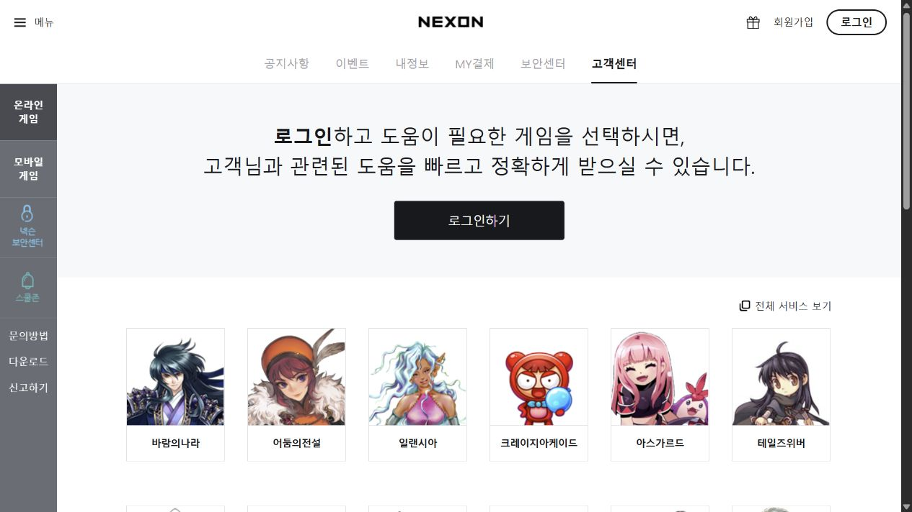

  

  <a href="../../README.md">프로젝트</a> / <a href="../../html/04_customer_service.html">HTML</a> / <a href="../../css/04_customer_service.css">CSS</a> / <a href="https://github.com/Cocode96">GitHub</a>

<b>고객센터의 상단 메뉴, 왼쪽 사이드바, 로그인 안내와 게임별 문의 카드를 구현하고 팀 진행 상황과 Git 작업을 함께 챙겼습니다.</b>

AX 1기 팀 프로젝트 / 팀장 / 고객센터 / HTML5 / CSS3

[화면 미리보기](#화면-미리보기) / [구현한 내용](#구현한-내용) / [회고](#회고)

## 화면 미리보기

프로젝트 당시 캡처입니다. 이미지를 누르면 크게 볼 수 있습니다.

## 구현한 내용

| 영역 | 구현 내용 |
| --- | --- |
| **본문과 사이드바** | 고정 너비의 왼쪽 메뉴와 남은 너비를 쓰는 본문을 Flex로 나눴습니다. 사이드바 안쪽 메뉴에는 sticky를 적용했습니다. [CSS 보기 →](../../css/04_customer_service.css#L202) |
| **로그인 안내** | 문구와 버튼을 세로로 배치하고, hover와 키보드 포커스에 같은 강조색을 적용했습니다. [CSS 보기 →](../../css/04_customer_service.css#L245) |
| **게임별 문의 카드** | 카드를 flex-wrap으로 줄바꿈하고 gap으로 간격을 맞췄습니다. 카드 크기는 유지하면서 hover 시 그림자가 변하도록 했습니다. [CSS 보기 →](../../css/04_customer_service.css#L315) |
| **팀 진행 관리** | 팀원들의 진행 상황을 확인하고 Git 작업 중 막히는 부분을 함께 확인했습니다. [관련 회고 →](#회고) |

**구현 범위** — 문의할 게임을 고르는 화면과 페이지 연결을 구현했습니다. 실제 문의 접수와 인증은 포함하지 않습니다. 로컬 이미지 준비는 [실행 환경 안내](../../README.md#이미지와-실행-환경)를 참고하세요.

## 회고

프로젝트를 마친 당시의 경험과 생각을 정리한 글입니다.

### 팀 진행 상황과 Git 관리

팀장을 맡아 팀원들의 진행 상황과 Git 작업을 함께 챙기면서, 전체 흐름을 파악하는 데 많은 확인이 필요했다. 각자 맡은 페이지를 작업하고 있었지만, 어디까지 진행됐고 어떤 부분에서 도움이 필요한지는 직접 확인해야 하는 경우가 있었다.

다음에 팀장을 맡게 된다면 프로젝트를 시작할 때 진행 상황을 언제, 어떤 방식으로 공유할지부터 정하고 싶다. 완료한 일, 진행 중인 일, 막힌 부분을 정기적으로 짧게 공유하고, 요청한 작업도 누가 맡았고 어디까지 처리됐는지 확인할 수 있도록 하려 한다.

작업 내용과 결정 사항은 한곳에 기록을 남기는 것을 기본으로 삼으려 한다. Git 작업 방식이나 문제를 해결한 과정도 문서로 남겨 팀원들이 함께 참고할 수 있게 하고 싶다. 내가 하나씩 확인하는 데 의존하기보다, 기록을 보면 서로의 진행 상황을 알 수 있는 방식으로 팀을 운영해보고 싶다.

---

[← 김민지 / 상품 목록](김민지.md) / [프로젝트 README](../../README.md) / [이승주 / 보안센터 →](이승주.md)
