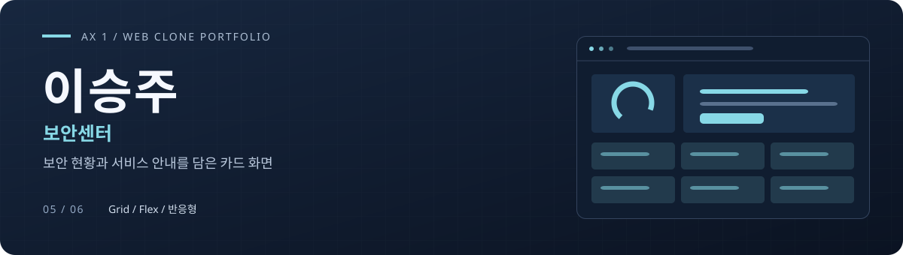
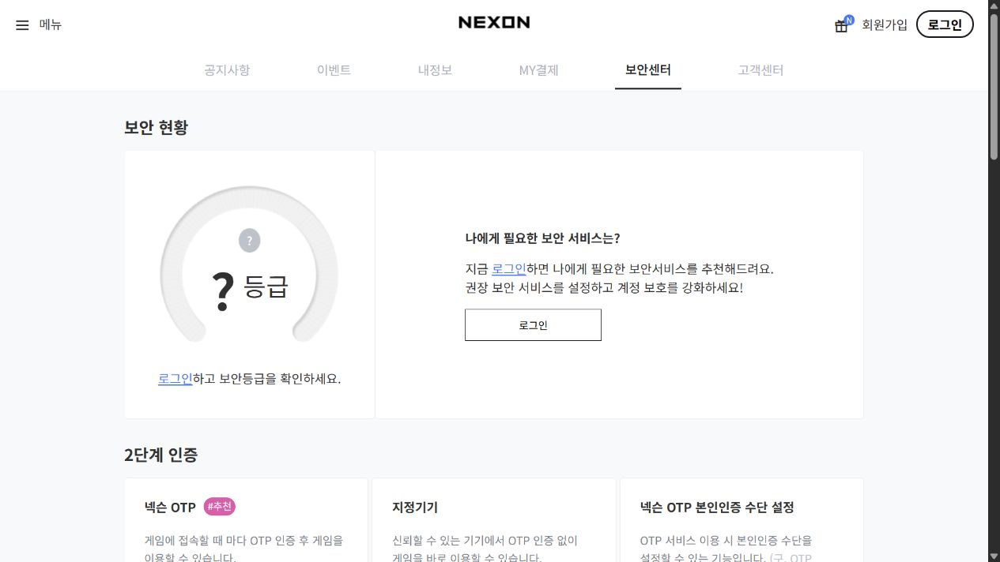

  

  <a href="../../README.md">프로젝트</a> / <a href="../../html/05_security_centre.html">HTML</a> / <a href="../../css/05_security_centre.css">CSS</a> / <a href="https://github.com/22S49">GitHub</a>

<b>보안 현황, 2단계 인증, 보안 서비스, 공지와 FAQ를 카드 단위로 나누어 구현했습니다.</b>

AX 1기 팀 프로젝트 / 보안센터 / HTML5 / CSS3

[화면 미리보기](#화면-미리보기) / [구현한 내용](#구현한-내용) / [회고](#회고)

## 화면 미리보기

프로젝트 당시 캡처입니다. 이미지를 누르면 크게 볼 수 있습니다.

## 구현한 내용

| 영역 | 구현 내용 |
| --- | --- |
| **보안 현황** | 등급 안내와 서비스 소개를 1:2 Grid로 나누고, 안내 문구와 버튼을 Flex로 가운데 정렬했습니다. [CSS 보기 →](../../css/05_security_centre.css#L257) |
| **인증과 보안 서비스** | 서비스 카드를 3열 Grid로 배치하고, hover 시 배경과 자식 요소의 글자색이 함께 바뀌도록 했습니다. [CSS 보기 →](../../css/05_security_centre.css#L377) |
| **화면 너비 대응** | 768px 이하에서 주요 카드는 1열로, FAQ는 2열로 바꾸고 상단 메뉴 표시를 조정했습니다. [CSS 보기 →](../../css/05_security_centre.css#L274) |
| **공지와 FAQ** | 공지 목록과 4열 FAQ를 구성했습니다. 제목이 없는 칸은 visibility로 제목 공간을 유지했습니다. [CSS 보기 →](../../css/05_security_centre.css#L269) |

**구현 범위** — 보안 서비스의 안내 화면을 구현했습니다. 인증 설정, 보안 등급 조회와 햄버거 메뉴 오버레이는 포함하지 않습니다. 로컬 이미지 준비는 [실행 환경 안내](../../README.md#이미지와-실행-환경)를 참고하세요.

## 회고

프로젝트를 마친 당시의 경험과 생각을 정리한 글입니다.

### 한 줄 요약

Grid와 Flex를 언제 써야 하는지에 대한 원칙은 아직 없다. 대신 “안 맞으면 값을 바꿔보고, 될 때까지 시도한다”는 방식으로 반응형 페이지 하나를 완성했다. 일단 얼추 똑같이 만드는 것이 목적이었다.

### Grid와 Flex를 나누어 쓴 방식

기준이 있어서 나눈 건 아니고, **칸을 나눌 때는 Grid, 한 줄 정렬에는 Flex**라는 손에 익은 습관대로 썼다.

- `.wrap1 { display: grid; grid-template-columns: 1fr 2fr; }`: 대시보드와 안내 영역을 두 칸으로 나눌 때 Grid를 선택했다.
- `.service-info { display: flex; align-items: center; justify-content: center; }`: 두 속성이 각각 어느 축을 담당하는지 구분하지 못해서, 둘 다 넣어보고 되는 조합을 그대로 썼다.
- `nav > div { width: 768px; display: flex; justify-content: space-between; margin: 0 auto; }`: 메뉴 버튼처럼 한 줄로 나열하는 곳에는 Flex를 사용했다.

대화 중에 Grid의 기본 정렬이 stretch로 동작해 `.wrap1` 안의 두 `.container` 높이가 맞춰진다는 설명을 들었다. 반대로 `align-items: center`를 넣었다가 높이가 맞지 않는 문제도 겪었다.

### 삽질 기록

1. `.wrap1`에 `align-items: center`를 넣었다가 두 영역의 높이가 맞지 않았다.
2. `<a>` 안에 `<a>`를 중첩하려다 막혀, ``과 JavaScript의 `onclick`으로 우회했다.
3. `margin: 10px` 하나로 의도하지 않은 들여쓰기가 생겼다.
4. hover 시 부모만 바뀌고 자식의 색은 바뀌지 않았다. `.container:hover .subtext`처럼 자식 요소를 직접 지정했다.
5. FAQ 카드 중 하나에만 제목이 없어 높이가 맞지 않았다. `visibility: hidden`으로 해결했다.
6. nav의 active 밑줄 위치가 nav와 main의 경계선에 맞지 않았다.
7. 그리드 칸마다 테두리를 따로 넣는 방법을 찾지 못해, 겹치는 부분을 배경색으로 덮었다.
8. 768px 브레이크포인트는 계산한 값이 아니라 화면을 좁혀보며 깨지는 지점을 눈으로 확인해 정했다.

### 코드 밖에서 겪은 문제와 미완성 항목

nav의 폰트가 적용되지 않는 문제가 있었다. 광고 차단 확장 프로그램이 jsDelivr CDN을 막았을 가능성을 생각했다.

Git 병합 충돌 후 `git commit`, `git push` 순서로 진행했지만 같은 오류가 반복되어 원인을 명확히 알지 못했다. 햄버거 메뉴 오버레이도 구현하지 못했다.

### 느낀 점

프로젝트에서 발생한 문제는 대부분 내 역량의 문제라고 느꼈고, 특히 Git이 제일 발목을 잡았다. Grid와 Flex는 시행착오로 밀어붙였다. 그래서 제대로 쓴 건지는 아직 모르겠다.

우리 팀은 다들 초반에는 속도가 느렸는데도 각자 맡은 페이지를 묵묵히 끝까지 책임지고 완성해냈다. 그 점이 멋있었다. 나는 문제가 생기면 말이 많아지는 편인데, 말을 줄이고 해결하는 데 집중해야겠다. 다른 팀원들의 코드도 살펴보면서 나와 다르게 쓴 부분을 찾아보고 싶다.

### 추가로 정리한 해결 계획

Git 오류가 발생했던 상황과 오류 메시지를 기록해 두었다. 기록을 바탕으로 좋지 않은 사용 습관이 있었는지 확인하고, 협업에서 Git을 쓰는 흐름을 익히고 싶다. 협업 기회가 많지 않은 만큼 다음 기회에는 더 주의해서 사용해볼 생각이다.

문제의 원인으로 지목된 OS 설정도 수정했다. 앞으로 같은 오류가 반복되는지 확인하고, 해결되지 않는다면 대처 방법이라도 익혀 이후에 해결 시간을 줄이고 싶다.

HTML/CSS는 당분간 여러 예제와 사례를 직접 구현하면서 감각을 익혀야 할 것 같다. 패턴이 익숙해지면 시행착오도 줄어들지 않을까 생각한다. Figma 같은 도구가 시행착오를 더 줄여줄 수 있을지도 궁금하지만, 지금은 코드를 쓰는 방법부터 익혀야 하는 단계라고 받아들이고 있다.

---

[← 양석호 / 고객센터](양석호.md) / [프로젝트 README](../../README.md) / [배경일 / 공지사항 →](배경일.md)
