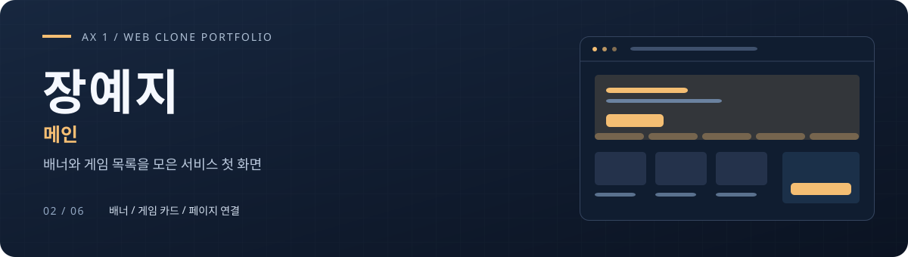
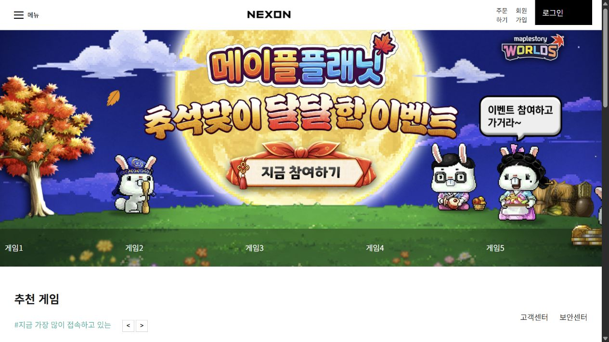

  

  <a href="../../README.md">프로젝트</a> / <a href="../../html/02_main_page.html">HTML</a> / <a href="../../css/02_main_page.css">CSS</a> / <a href="https://github.com/yeji-jang">GitHub</a>

<b>대표 배너부터 추천 게임, 로그인 영역, 전체 게임 목록까지 넥슨의 첫 화면을 나누어 구성했습니다.</b>

AX 1기 팀 프로젝트 / 메인 / HTML5 / CSS3

[화면 미리보기](#화면-미리보기) / [구현한 내용](#구현한-내용) / [회고](#회고)

## 화면 미리보기

프로젝트 당시 캡처입니다. 이미지를 누르면 크게 볼 수 있습니다.

## 구현한 내용

| 영역 | 구현 내용 |
| --- | --- |
| **대표 배너와 메뉴** | 큰 배너 위에 하단 메뉴를 겹쳐 배치하고, 메뉴 다섯 칸을 Grid로 나눴습니다. [CSS 보기 →](../../css/02_main_page.css#L97) |
| **추천 게임과 로그인** | 추천 게임 카드를 Flex로 나열하고, 로그인 박스를 같은 행에 배치했습니다. [CSS 보기 →](../../css/02_main_page.css#L211) |
| **전체 게임 목록** | 썸네일, 게임명, 장르, 플랫폼 아이콘과 이벤트 배지를 묶어 카드로 구성했습니다. [CSS 보기 →](../../css/02_main_page.css#L401) |
| **팀 페이지 연결** | 로그인, 상품 목록, 고객센터, 보안센터, 공지사항으로 이동하는 링크를 연결했습니다. [HTML 보기 →](../../html/02_main_page.html) |

**구현 범위** — 게임 소개와 페이지 이동을 구현했습니다. 검색, 필터, 배너 전환과 로그인은 화면 구성 단계입니다. 로컬 이미지 준비는 [실행 환경 안내](../../README.md#이미지와-실행-환경)를 참고하세요.

## 회고

프로젝트를 마친 당시의 경험과 생각을 정리한 글입니다.

### 좋았던 점

개발자 도구(F12)로 실제 서비스의 HTML/CSS를 직접 열어보며 구조를 읽는 연습을 할 수 있었다. 디자인을 보는 것보다 그 뒤의 레이아웃 구조를 파악하는 것이 훨씬 중요하다는 점을 이해했다.

평소 터미널 명령어로만 익히던 Git/GitHub 작업을 이번에는 Fork로 해볼 수 있었다. GUI로 협업하는 흐름을 직접 경험하고 익힐 수 있는 좋은 기회였다.

### 아쉬웠던 점

- 일단 되게만 만들고 넘어간 부분이 많았다.
- 팀 논의가 필요한 사항들을 결정하지 못한 채 넘어간 경우가 많았다.
- 참고 디자인과의 격차를 단순화라는 말로 정리하고 넘어간 경우가 있었다.
- 코드 중간에 남은 실수와 작업 흔적을 충분히 정리하지 못했다.
- 각자 역할은 나눴지만 코드만 형상 관리했고, 구현하다가 발견한 내용은 서로 공유하지 못했다.
- 과제를 수행할 시간이 절대적으로 부족했다.

HTML/CSS 기초 과정을 끝낸 지 하루 만에 프로젝트를 수행하다 보니, 필요한 키워드를 찾는 것부터 어려웠다. 개념을 충분히 이해하고 적용할 여유가 부족했다.

---

[← 원정린 / 로그인](원정린.md) / [프로젝트 README](../../README.md) / [김민지 / 상품 목록 →](김민지.md)
